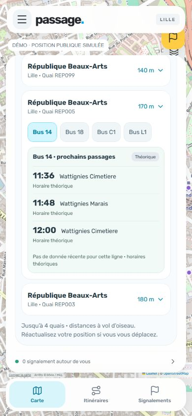
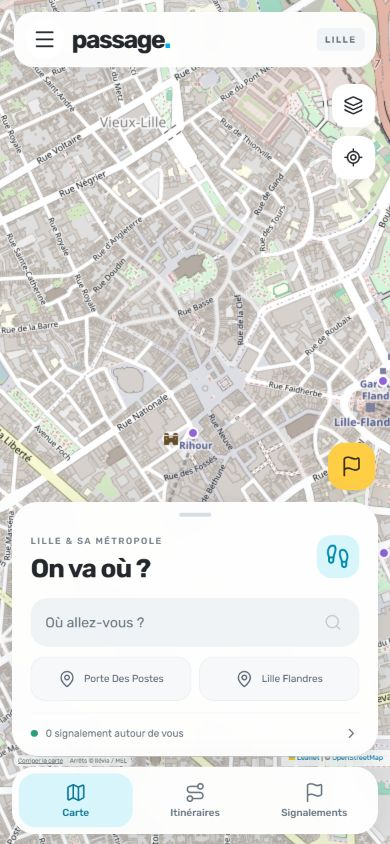
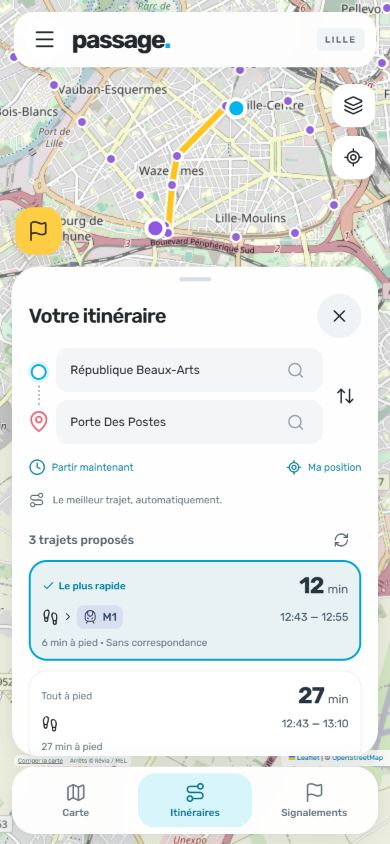
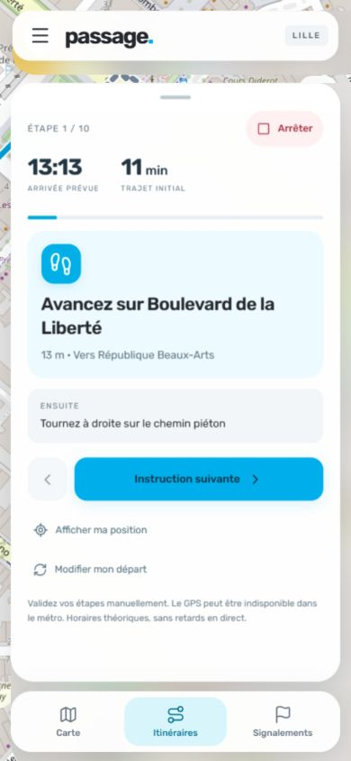

<div align="center">
  
  <h1>Passage</h1>
  <p><strong>A map-first walking and public transport prototype for Lille.</strong></p>
  <p>React · Leaflet · Node.js · SQLite · Capacitor</p>
  <p>English documentation · French application interface</p>
</div>

---

> **Source code only — not a public service.** This repository documents an experimental application. The application will not be published on app stores or launched as a public service because its ticket-inspector reporting features raise unresolved legal and privacy questions. No APK, hosted demo, or production release is provided. This is a project decision, not a legal determination that publishing the source code resolves those questions.

## The idea

Passage combines pedestrian directions, public transport connections and short-lived community reports in one map-first interface. It focuses on Lille and its metropolitan area, with a shared web interface and Android wrapper. Navigation patterns take inspiration from familiar mapping applications; Passage is an independent prototype, unaffiliated with Waze, Google, Apple or Ilévia.

## New: nearby departures

Find up to four physical stops/platforms within 800 metres from the home screen, then choose a line to see upcoming departures. Location is requested only when you tap the button and is not stored. Distances are straight-line estimates; refresh your position after moving. Bus, metro and tram schedules are supported; live information appears only when fresh matching SIRI visits exist, otherwise scheduled GTFS times are clearly labelled.

<table><tr>
<td align="center"><strong>Home shortcut</strong><br></td>
<td align="center"><strong>Nearby bus platform</strong><br></td>
</tr></table>

Captured at 390 × 844 on October 13, 2026. The bus screenshot uses a labelled simulated public location and actual scheduled fallback data, not the user's location or invented live arrivals. See [verification notes](docs/nearby-departures.md).

## Mobile screenshots

Phone-format development captures of the French interface, reviewed for personal information. These show public places and example screens, with no personal account details or uploaded photos. Some layouts predate the latest source changes.

<table>
  <tr>
    <td align="center" width="50%"><strong>Map-first home</strong><br><a href="docs/screenshots/map.jpg"></a></td>
    <td align="center" width="50%"><strong>Journey alternatives</strong><br><a href="docs/screenshots/journeys.jpg"></a></td>
  </tr>
  <tr>
    <td align="center" width="50%"><strong>Step-by-step guidance</strong><br><a href="docs/screenshots/guidance.jpg"></a></td>
    <td align="center" width="50%"><strong>Report composer</strong><br><a href="docs/screenshots/report.jpg"></a></td>
  </tr>
</table>

Click a screenshot to view it at full size. Map attribution is preserved.

## What is implemented

| Area | Capabilities |
| --- | --- |
| Journey planning | Automatic comparison of walking and scheduled bus, metro and tram journeys, including access walks, waiting and transfers. |
| Navigation | Start/stop guidance, foreground pedestrian GPS progression, off-route recalculation, optional voice instructions and selectable route alternatives. |
| Transit guidance | Step-by-step boarding and alighting instructions, proximity hints and explicit confirmations for transit steps. |
| Bus departures | Fresh Ilévia SIRI stop-monitoring data when available, expected departures and delays, with scheduled GTFS fallback. |
| Personal space | Account registration, login, one-use recovery keys, home/work destinations and saved journeys. |
| Home shortcuts | Launch saved destinations and manage home/work or remove favorites directly from the home screen. |
| Community reports | Stop- and line-based ticket-inspector reports, confirmations, automatic expiry and optional photo attachments. |
| Interface | Responsive map-first panels, custom controls, cyan accents and keyboard focus states. |

The remaining requested additions—opt-in offline storage, profile avatars, mandatory account login for reporting, and a dedicated disruptions feed—are **not implemented in this snapshot**. Reports currently use anonymous device sessions, with optional account association.

## Important limitations

- Journey ranking and estimated arrival times use **scheduled** transit data. Live bus information does not change the journey planner's ranking.
- Live data is not guaranteed for every stop or mode. There is no claim of fresh metro coverage, complete network disruption coverage, or live road congestion.
- Transit lines are drawn schematically between stops; walking sections use pedestrian routing geometry.
- GPS guidance operates in the foreground. Background navigation and screen-off behavior have not been validated on a physical Android device.
- GPS cannot reliably identify which bus a person boarded. Transit hints require explicit confirmation.
- Photos and community reports are unverified. Session-based rate limits are not proof of identity.
- This is a local prototype, not a production-ready transport or safety service.

## Run locally

Requirements: **Node.js 24**, npm, **Python 3** and an internet connection for the public mapping and transit providers. Run these commands from the repository root.

```sh
npm ci
```

Download the current [Ilévia GTFS archive](https://media.ilevia.fr/opendata/gtfs.zip) to a location outside the repository, then import **the same archive** with both scripts:

```sh
python scripts/import-gtfs.py /path/to/gtfs.zip
python scripts/import-timetable.py /path/to/gtfs.zip
npm run build
npm start
```

Open **http://127.0.0.1:4311**. The Node server serves both the built frontend and the API. To work on the frontend, keep the API running and run `npm run dev` in a second terminal.

The generated `resources/timetable.sqlite` is intentionally excluded from Git: it is large and can be rebuilt. The included `public/transit.json` is an open-data snapshot; regenerate it alongside the timetable to keep both datasets consistent. The October 12, 2026 snapshot contains **3,328 served stops/platforms and 157 routes**; later feeds may differ.

### Configuration

See [`.env.example`](.env.example) for runtime and build-time settings. `npm start` does not automatically load this file; pass variables through your shell or use Node's `--env-file` option with a local file. Never commit that local file.

- `HOST` / `PORT`: local server binding; defaults to `127.0.0.1:4311`.
- `DB_PATH`: private application database, separate from the public timetable.
- `ALLOWED_ORIGINS`: permitted browser origins.
- `MAPS_USER_AGENT`: identify your client to external mapping providers.
- `ROUTER_URL` / `GEOCODER_URL`: routing and geocoding providers.
- `VITE_API_URL` / `VITE_TILE_URL`: frontend settings applied during build.

Public provider endpoints have usage policies and capacity limits. Do not bulk-download map tiles or treat public endpoints as unlimited production infrastructure.

## Android development

The Capacitor project requires **JDK 21**, **Android SDK 36** and **Build Tools 36**, with the Android SDK licenses accepted by the developer. The project targets API 36 and supports Android API 24 and newer.

For a local development build on Windows:

```powershell
./scripts/build-android.ps1 -SdkRoot C:/Android/sdk -JavaHome C:/Java/jdk-21
```

This generates an ignored debug APK for local testing. No binary is published in this repository. The native application still needs the Node API; building an APK does not bundle the server or timetable database. Configure the API address in the app's settings. Android execution has not been verified on a physical device.

## Architecture

```text
src/         React interface, Leaflet map, account and guidance screens
server/      HTTP API, SQLite persistence, transit planner and realtime adapter
public/      App assets, generated stop catalog and third-party notices
resources/   Generated timetable database (not tracked)
scripts/     GTFS import and build utilities
tests/       API, account, routing, guidance and data handling tests
android/     Capacitor Android project
worker/      Static hosting scaffold; does not replace the Node API
```

Accounts use salted scrypt password hashes. Recovery keys are stored as hashes, rotate after use and invalidate existing sessions when a password is reset. Uploaded report images are decoded and re-encoded server-side to strip metadata. Private application data lives under `data/` by default and is excluded from version control.

## Checks

```sh
npm test
npm run build
npm run test:sites
```

Tests use temporary application databases. Automated checks do not establish real-world GPS accuracy or full transport coverage. The static hosting scaffold does **not** implement the SQLite-backed Node API.

## Data and acknowledgements

- **Ilévia / MEL:** [GTFS and realtime dataset](https://transport.data.gouv.fr/datasets/ilevia-localisation-des-arrets-bus-metro-et-tram-gtfs), with scheduled data under the [French Open Licence 2.0](https://www.etalab.gouv.fr/licence-ouverte-open-licence/). The imported catalog and timetable are derived from this data; they are not private application databases.
- **OpenStreetMap contributors:** map data and attribution, with [tile usage](https://operations.osmfoundation.org/policies/tiles/) and [Nominatim usage](https://operations.osmfoundation.org/policies/nominatim/) policies.
- **OSRM / FOSSGIS:** [pedestrian routing service](https://routing.openstreetmap.de/about.html).
- **Turf:** `src/distance.js` adapts the MIT-licensed distance calculation from the public [wazeHQ/turf fork](https://github.com/wazeHQ/turf/tree/b18cdda4c81487f814634b6bd0c850dbf63017be). This is a geographic utility, not Waze's proprietary routing engine. See [the retained MIT notice](public/licenses/turf-MIT.txt).
- **React, Leaflet, Capacitor, Lucide and Rubik:** interface foundations, mapping, native bridge, icons and type. Retained asset notices are in [`public/licenses/`](public/licenses/); dependencies retain their own licenses.

No third-party APKs, decompiled application code, proprietary map assets, credentials or private API access are distributed here. Names of other products identify references only.

## Publication and licensing

This is a **public source repository**, not an application launch. No public deployment, app-store release or downloadable application is planned because of the unresolved legal and privacy issues described above.

No general open-source license is granted for the project's original code in this snapshot. Public visibility alone does not grant an unrestricted license to reuse it. Third-party code, assets and datasets remain governed by their respective licenses and notices.
