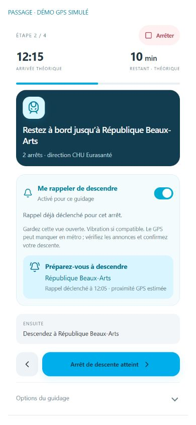

# Optional alighting reminder

Delivered October 18, 2026. During active guidance, enable **Me rappeler de descendre** for that journey. It is off by default. After manual boarding confirmation, the app can display a reminder near the destination stop of a bus, metro or tram leg and request a short vibration when supported.

Two distinct GPS fixes must be within 100 metres of the stop, span at least two seconds and be no more than ten seconds apart. Each fix must pass the existing accuracy (25 metres maximum) and freshness (ten seconds maximum age) checks. Disabled tracking, hidden pages, invalid fixes and leaving the radius reset the pending sample. Each leg can trigger once; toggling the option does not repeat it. A new guidance session resets it.

The reminder does not confirm boarding or alighting, advance a transit step, or detect a vehicle. Keep the app visible. Underground GPS may be missing, and vibration depends on device/browser support. Check vehicle announcements and confirm your descent manually. The displayed trigger time describes a past proximity estimate, not continuous live vehicle tracking.

## Verification

- 65 automated tests, including duplicate fixes, stale/future/inaccurate fixes, disabled/background states, distance, sample gaps, all three transport modes and independent transfer legs.
- Production build and four static hosting checks passed.
- Mobile 390 × 844: opt-in, two-sample trigger, one simulated vibration, no repeat after another fix or disable/re-enable, and manual advancement to the alighting step.
- HTTP tests use disposable databases. The isolated GPS preview needs no account or backend database.

This fresh capture shows the real Guidance component in the development-only fixture at /tests/fixtures/alighting-preview.html. The journey and GPS are simulated at public Lille stations; vibration calls are counted rather than sent to hardware. No personal location, account or private data is used. This is not a real-world GPS or physical-device vibration test. No map tiles are shown. Public station names: Ilévia / MEL.

To reproduce, run npm run dev, open that fixture, enable the reminder, confirm boarding, then press the nearby-position button twice two to ten seconds apart. Test fixtures are not included in the production build.
