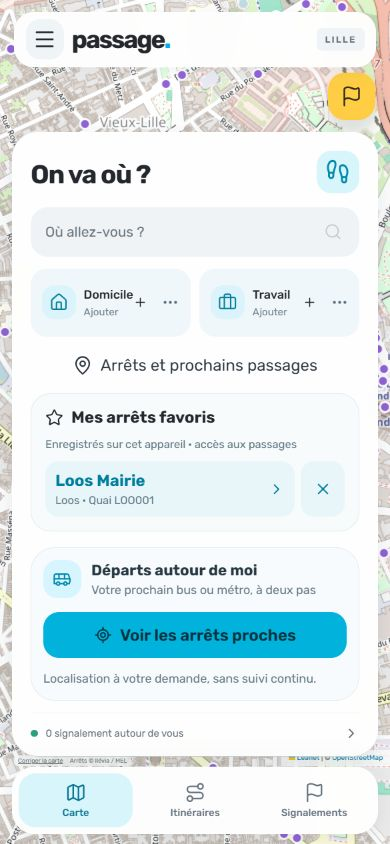

# Favorite physical stops

Delivered October 21, 2026. Add a physical platform from its stop-detail card, then open its departures directly from **Mes arrêts favoris** on home. Remove it from either surface. These shortcuts are separate from favorite destinations, home and work.

Up to twelve platform identifiers are stored in this browser/device's local storage. They are not synchronized with an account, and remain on a shared device after logout. Only public platform IDs are saved; the current catalog supplies names and coordinates. No GPS history, account details or departure predictions are cached. Remove saved stops explicitly or clear the site's storage. A missing catalog ID remains removable and cannot open an incorrect replacement platform.

Invalid stored values are normalized and duplicates removed. Storage failures display an error rather than falsely confirming a saved change. Opening a favorite uses the existing stop details and departure status handling, including scheduled fallback and unavailable data.

## Verification

73 tests, four hosting checks and production build passed. Added tests cover distinct physical IDs, save/read/remove, duplicate and malformed data, unavailable storage, capacity limits and failed writes without mutation.

Mobile 390 × 844: added Loos Mairie LOO001, reloaded and verified persistence; opened its destination-labelled departures from home; removed from the detail card, added again and removed from home; reloaded and verified removal. Preview and HTTP tests used disposable databases with rebuilt public GTFS data. No personal GPS or account was used.

Fresh October 21 capture. Map © OpenStreetMap contributors; stop catalog © Ilévia / MEL. This saved stop is demonstration data.
