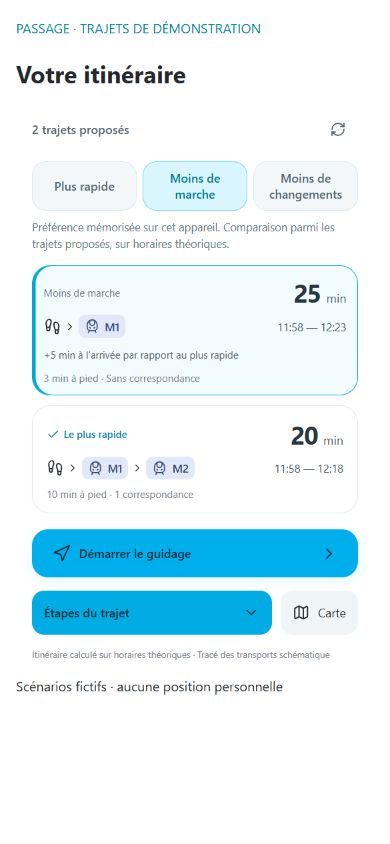

# Remembered journey preferences

October 19, 2026: results offer **Plus rapide**, **Moins de marche** and **Moins de changements**. The choice is saved locally on the device, used for subsequent calculations, and can be changed without hiding alternatives. A manual choice of another result remains possible.

Sorting uses walking seconds or transfer count, then scheduled arrival and walking time for ties. The fastest-arrival badge is calculated independently of display order. Slower arrivals show the extra rounded-up minutes. These preferences compare only the alternatives returned by the existing planner; they do not claim a network-wide optimum, accessibility routing, or live delay-aware ranking.

Only the preference identifier is stored. It is device-wide, not an account setting. Invalid/unavailable reads fall back to fastest arrival; write failure keeps the current choice and displays a warning.

## Verification

68 tests, production build and four hosting checks passed. Tests cover all three rankings, tie-breaking, source-array preservation, empty results and invalid/unavailable storage. HTTP tests use temporary databases with a rebuilt public GTFS timetable.

Mobile 390 × 844 checks: change each preference, verify selected result and independent fastest badge, reload and verify persistence. The screenshot is a fresh browser capture of the real JourneyResults component in the development-only /tests/fixtures/preferences-preview.html harness. Its routes are explicitly fictional examples, not actual service claims. No GPS, account or backend database is needed by this isolated preview. No map tiles are displayed.

