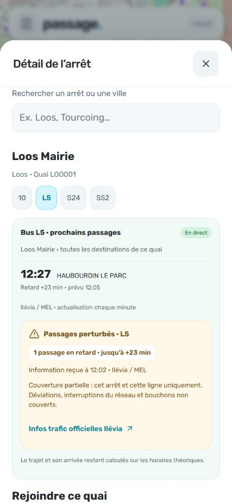

# Physical stop details

Delivered October 20, 2026. The home shortcut and displayed map stop markers open the same detail dialog. Search retains physical platform IDs instead of merging opposite directions with the same name. Search returns up to twelve matching served platforms; refine the query when needed. The map displays up to ninety served stops in its viewport; search covers the full loaded catalog.

Choose a served line to read departures and their destinations for that platform. The existing departure component retains live, theoretical, expired/unavailable and partial-disruption distinctions. Destinations come from the source, not an inferred direction. A platform can serve multiple destinations. This is not a complete traffic-alert feed.

Choose a start point and request a walking-only route to the selected platform coordinates. The existing planner and pedestrian router provide the route and guidance. Platform position is catalog data, not a guarantee of a particular accessible entrance or precise boarding door. Normal destination selection restores multimodal routing.

## Verification

70 tests, four hosting checks and production build passed. Added tests ensure identical stop names keep separate physical IDs, unserved points are excluded, and accent/city/empty searches behave correctly. Existing planner tests cover walking-only routing. HTTP tests and browser preview use disposable databases; the public GTFS timetable was rebuilt before tests.

Mobile 390 × 844: searched Loos Mairie, selected LOO001, switched from line 10 to L5, verified destination-labelled public departures, selected public stop Curie as departure and obtained a single 17-minute walking route. No personal GPS or account was used. The observed L5 delay was supplied by the public realtime endpoint, not fabricated.

Stops/departures © Ilévia / MEL. Background map © OpenStreetMap contributors. Screenshot reflects the capture time, not a current travel advisory.
